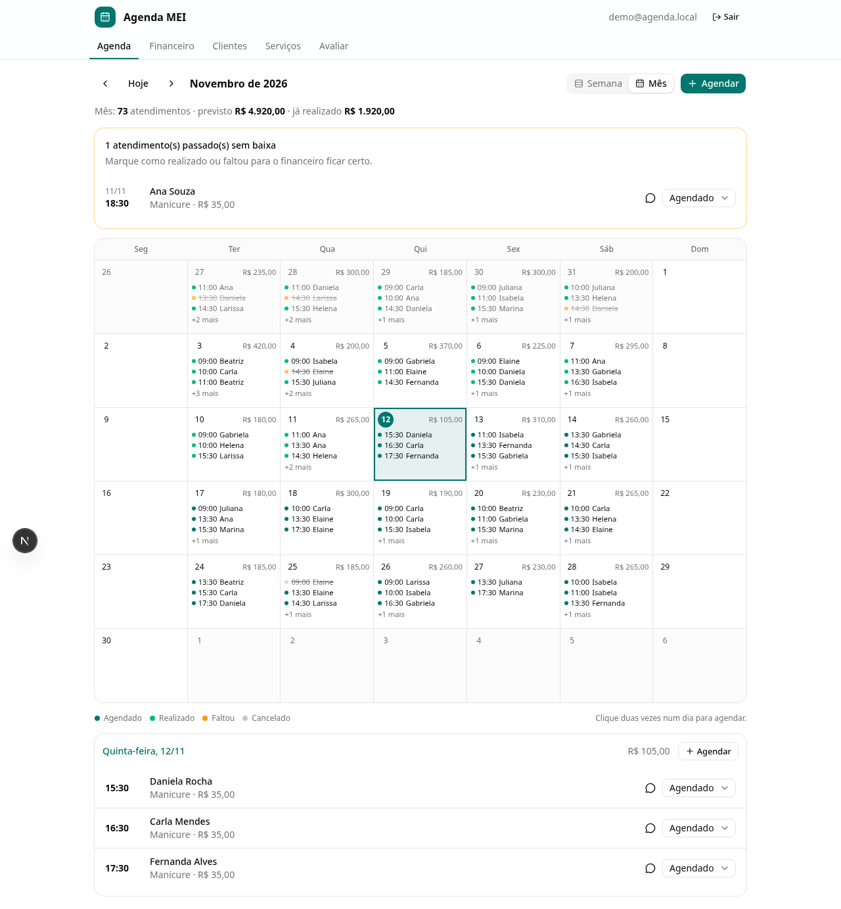

# Agenda MEI

[](https://github.com/davidosanjoss/agenda-faculdade/actions/workflows/ci.yml)

Agenda e previsão de faturamento para profissionais autônomos de atendimento, como manicures, cabeleireiros e fisioterapeutas. É o projeto do **PIT II (Engenharia de Software)** e do projeto de extensão ligado ao **ODS 8, meta 8.3**: apoio a microempreendedores.



## Funcionalidades

- **Agenda** da semana e calendário do mês, com a situação de cada atendimento (agendado, realizado, faltou, cancelado), aviso de conflito de horário e lembrete pelo WhatsApp.
- **Financeiro**: previsão do mês, realizado, a receber, perdido com faltas, ticket médio e comparação com os últimos 6 meses.
- **Clientes e serviços** cadastrados automaticamente ao agendar.
- **Avaliação dos testadores** com prints e **laudo de qualidade** imprimível (PIT II, Situação 3).
- Login por e-mail; cada profissional vê só os próprios dados (Row Level Security).

## Tecnologias

Next.js 16 (TypeScript, App Router, Server Actions) · shadcn/ui + Tailwind 4 · Supabase (PostgreSQL 17, Auth, Storage) · Vercel · Vitest · Playwright · GitHub Actions

## Documentação

Toda a documentação do PIT fica em [`docs/`](docs/README.md), organizada por situação-problema: requisitos, UML, IHC, dicionário de dados, arquitetura MVC, manual de uso, plano de testes e laudo.

## Rodar localmente

```bash
npm install
supabase start                                          # Postgres, Auth e Storage locais
cp .env.example .env.local                              # preencha com os valores de `supabase status`
node --env-file=.env.local scripts/dados-exemplo.mjs    # conta de demonstração com dados
npm run dev                                             # http://localhost:3000
```

Detalhes e publicação na Vercel: [docs/situacao-2-desenvolvimento/03-instalacao-e-deploy.md](docs/situacao-2-desenvolvimento/03-instalacao-e-deploy.md).

## Testes

| Comando | O que roda |
|---|---|
| `npm test` | 73 testes de unidade: regras de negócio e componentes React |
| `npm run test:integracao` | 20 testes de integração: controller, permissões e Storage contra o Postgres local |
| `npm run test:e2e` | 5 testes de sistema no navegador (Playwright) |
| `npm run lint` · `npm run typecheck` | Padrão de código e tipos |
| `npm run docs:capturas` | Gera as capturas de tela do manual |

Todos rodam no GitHub Actions a cada push.
