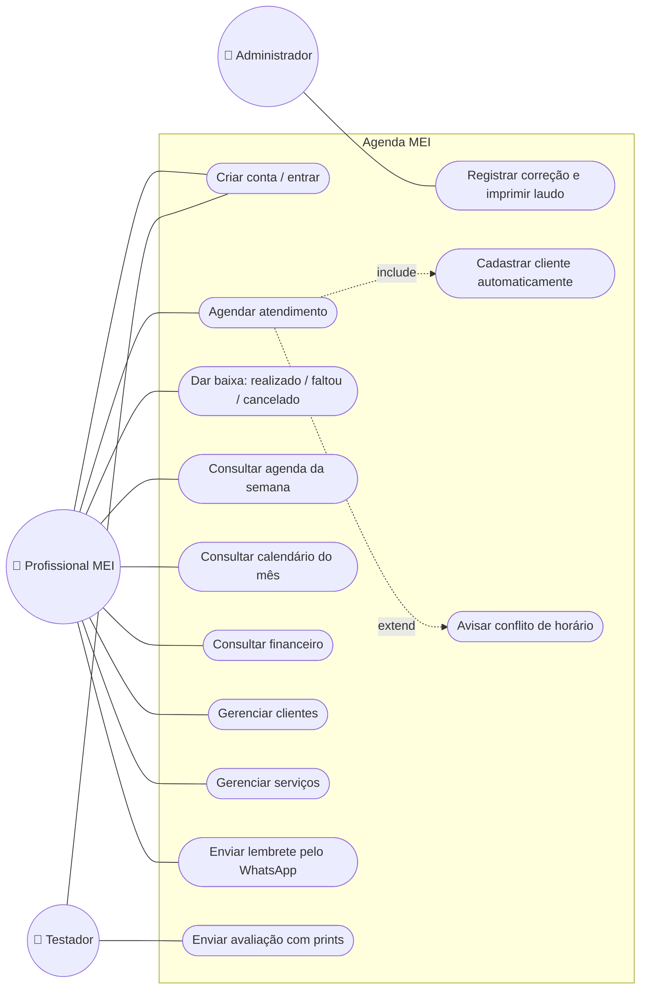
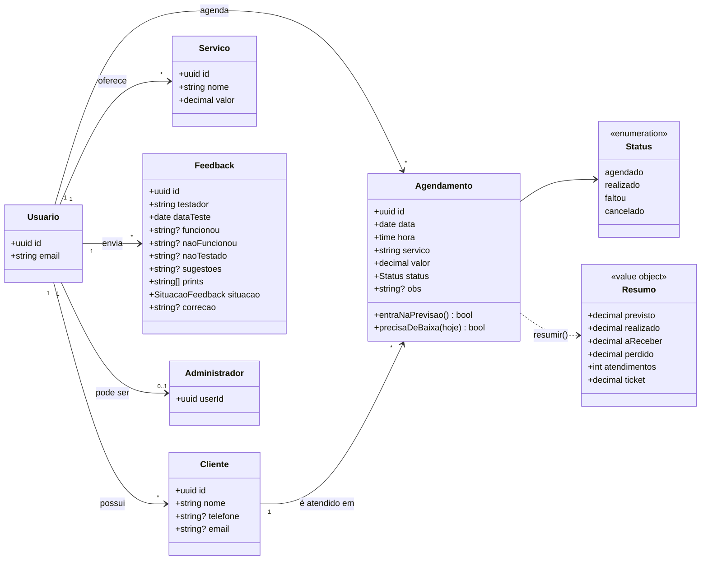
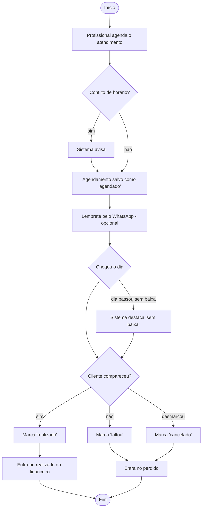
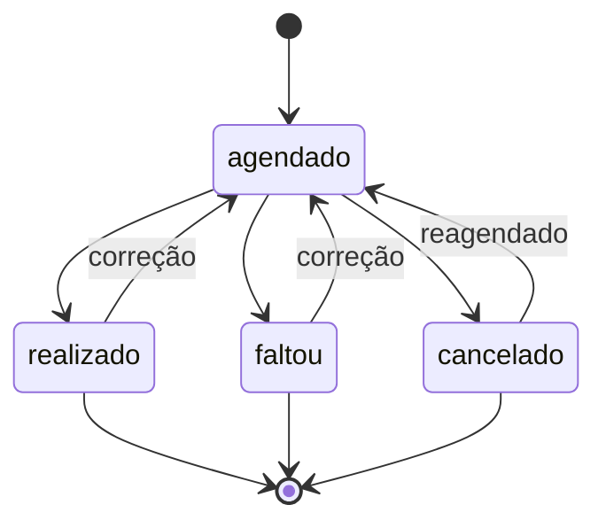

# Modelagem UML

Os diagramas usam [Mermaid](https://mermaid.js.org/), que o GitHub desenha automaticamente.

## Casos de uso



## Diagrama de classes (domínio e persistência)



## Sequência: salvar um agendamento

```mermaid
sequenceDiagram
  actor P as Profissional
  participant V as View<br/>(DialogoAgendamento)
  participant C as Controller<br/>(salvarAgendamento)
  participant M as Model<br/>(validacao.ts)
  participant DB as PostgreSQL<br/>(Supabase + RLS)

  P->>V: preenche cliente, serviço, valor
  V->>V: busca cliente/serviço conhecido<br/>e preenche contato e preço
  V->>V: avisa conflito de horário (se houver)
  P->>V: clica em Salvar
  V->>C: salvarAgendamento(dados)
  C->>M: validarAgendamento(dados)
  alt dados inválidos
    M-->>C: { ok: false, erro }
    C-->>V: erro
    V-->>P: mensagem de erro (formulário continua aberto)
  else dados válidos
    M-->>C: dados normalizados
    C->>DB: busca cliente pelo nome (ILIKE)
    alt cliente novo
      C->>DB: INSERT clientes
    else cliente existente
      C->>DB: UPDATE telefone/e-mail (se mudaram)
    end
    C->>DB: busca serviço; INSERT se for novo
    C->>DB: INSERT/UPDATE agendamentos
    DB-->>C: ok (RLS confere o dono)
    C->>C: revalidatePath("/")
    C-->>V: { ok: true }
    V-->>P: "Agendamento criado." e lista atualizada
  end
```

## Atividades: ciclo de um atendimento



## Estados de um agendamento


