# Interface Humano-Computador (IHC)

## Mapa de navegação

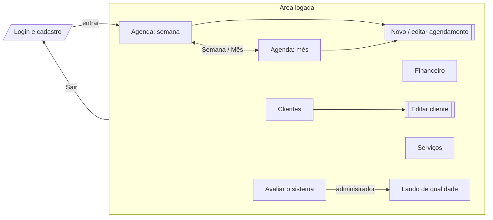

O menu superior fica igual em todas as telas: **Agenda · Financeiro · Clientes · Serviços · Avaliar**. A aba atual fica sublinhada.

## Telas

As capturas são geradas automaticamente pelo teste `tests/e2e/capturas.spec.ts` (`npm run docs:capturas`).

| Tela | Captura |
|---|---|
| Login / criar conta | 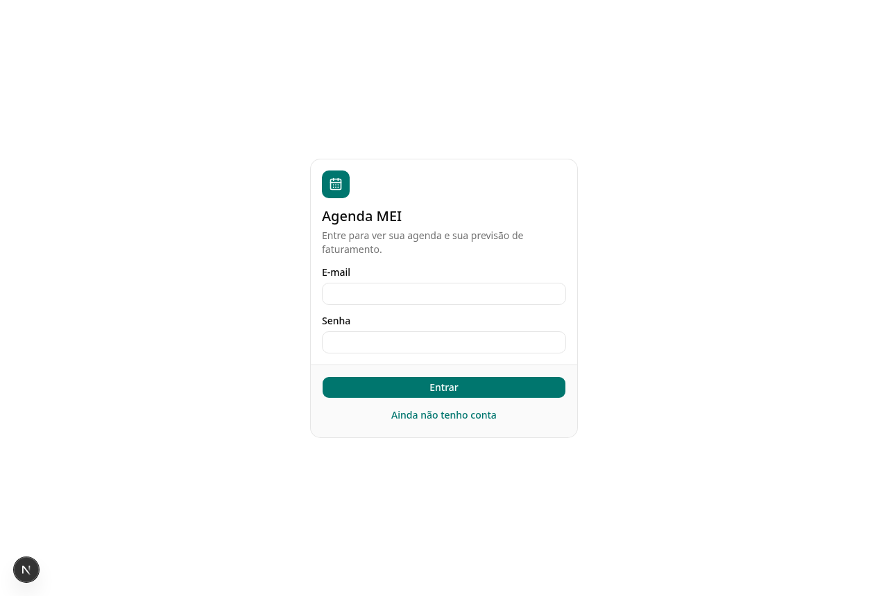 |
| Agenda da semana | 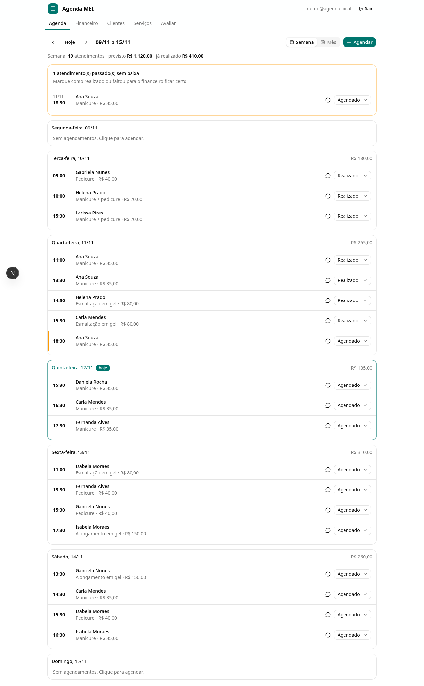 |
| Novo agendamento | 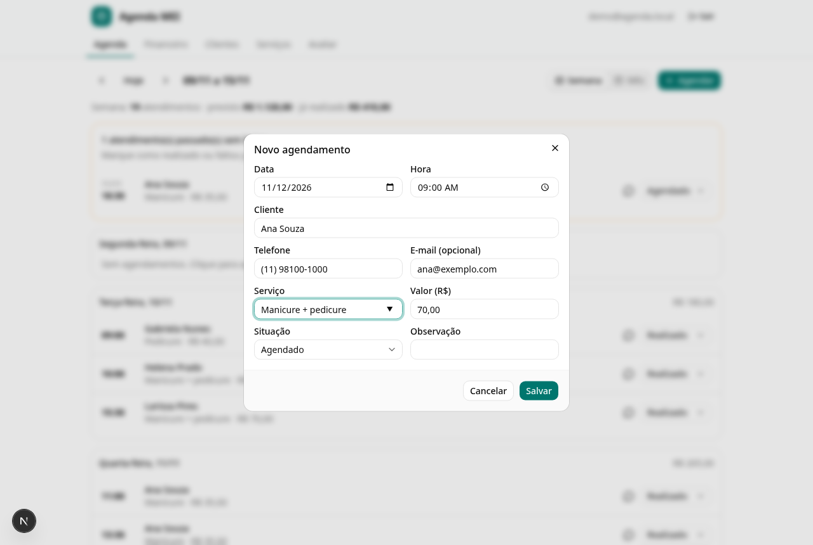 |
| Calendário do mês | 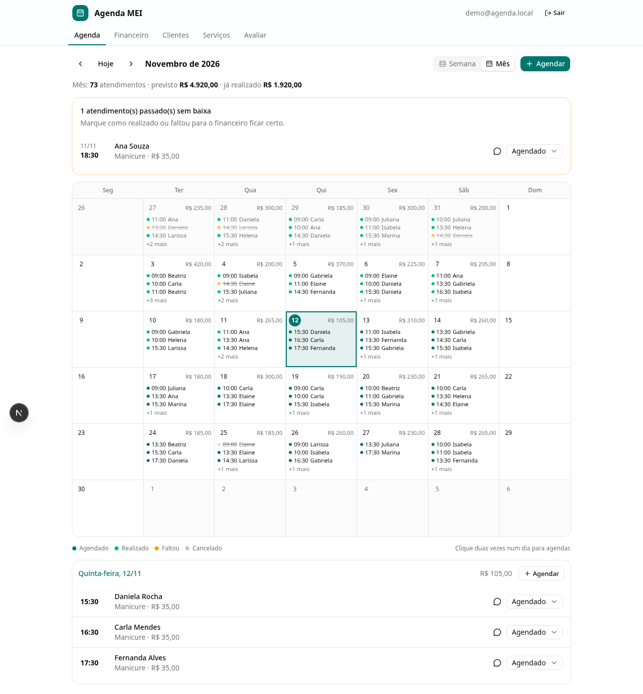 |
| Financeiro | 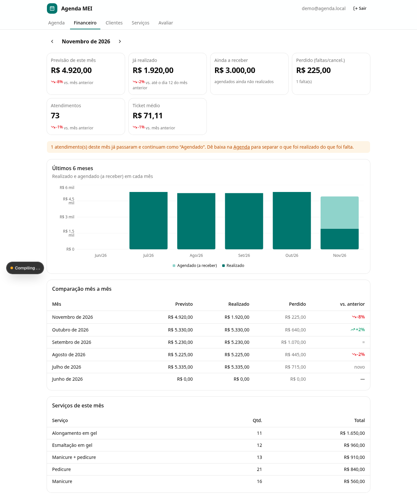 |
| Clientes | 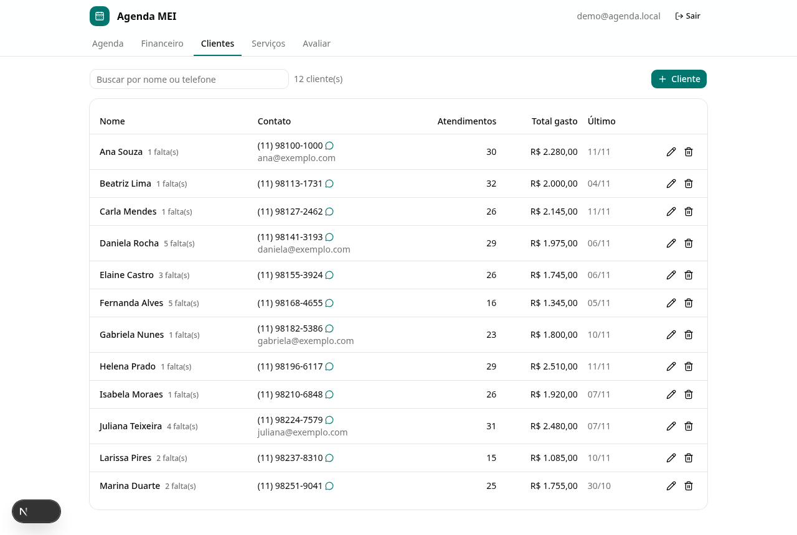 |
| Serviços | 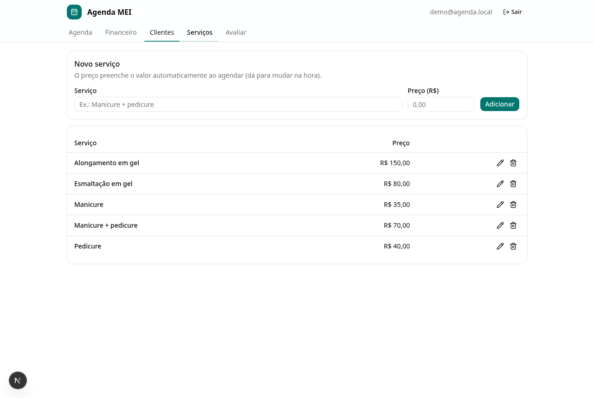 |
| Avaliar o sistema | 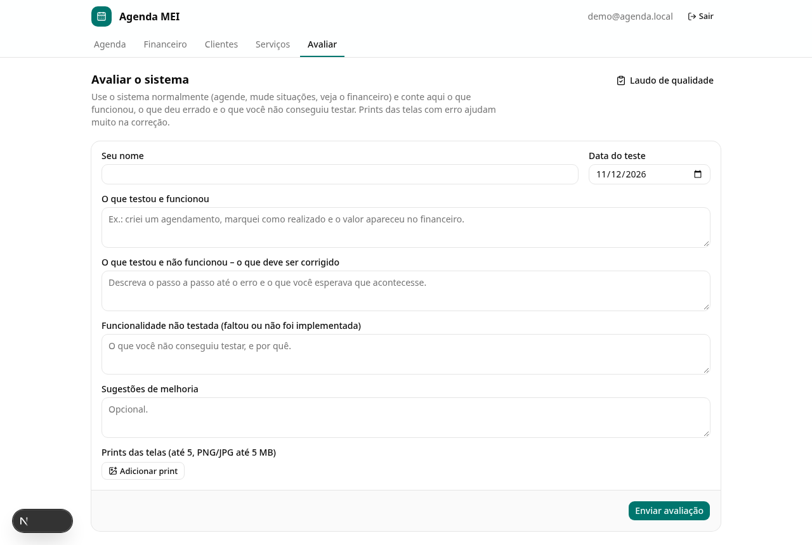 |
| Laudo de qualidade | 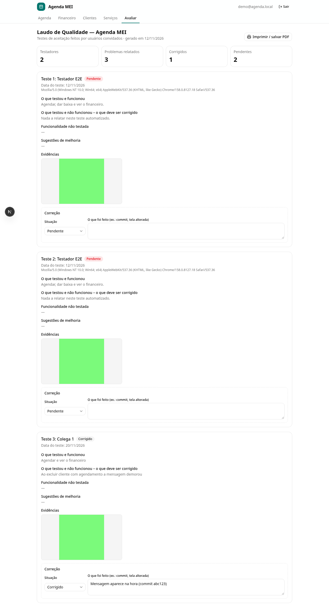 |
| Celular: mês e semana | 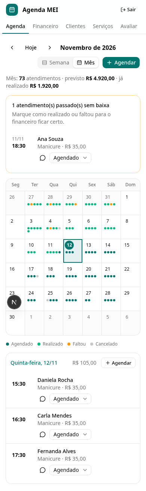 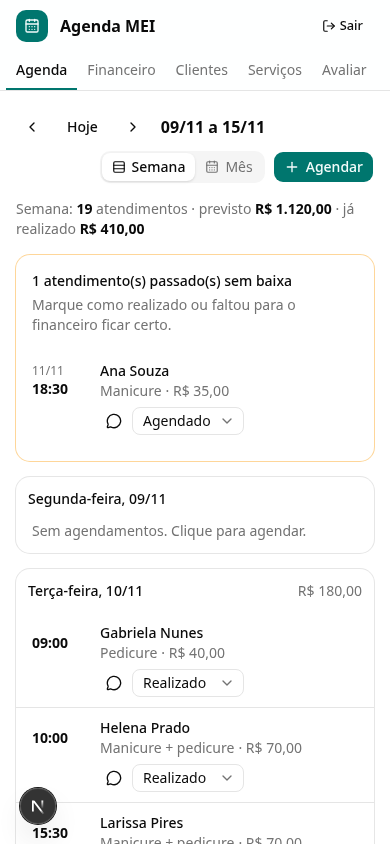 |

## Princípios aplicados

Seguindo as diretrizes do material da disciplina (*usability.gov*) e os princípios de Norman:

| Princípio | Como aparece no sistema |
|---|---|
| **Clareza** | Rótulos em português simples (“Ainda a receber”, “Perdido”); cada número do financeiro traz uma explicação curta. |
| **Consistência** | Mesmo menu, mesmos botões (“+ Agendar”), mesmo formulário de agendamento nas visões de semana e de mês. |
| **Simplicidade** | Um único formulário cadastra atendimento, cliente e serviço; não é preciso cadastrar o cliente antes. |
| **Padrões inteligentes** | Data de hoje e 09:00 já preenchidas; telefone, e-mail e preço vêm do cadastro quando o nome é reconhecido. |
| **Feedback** | Mensagens de sucesso e erro (toasts), botões mostram “Salvando...”, esqueleto de carregamento nas telas. |
| **Prevenção de erros** | Aviso de conflito de horário; aviso de cliente novo; destaque de atendimentos sem baixa. |
| **Reversibilidade** | A situação pode ser alterada a qualquer momento; edição de qualquer agendamento; “Tentar de novo” na tela de erro. |
| **Controle do usuário** | Conflito é aviso, não bloqueio; o valor sugerido pode ser alterado. |
| **Cor e hierarquia** | Cor primária só em ações e no dia de hoje; verde = realizado, laranja = faltou, cinza = cancelado; valores principais em fonte maior. |
| **Acessibilidade** | Todos os campos têm `<label>`; navegação por teclado (componentes Base UI); `aria-label` nos botões só com ícone; contraste do tema shadcn. |

## Mensagens do sistema

### Erros de validação (formulários)

| Mensagem | Quando aparece |
|---|---|
| Informe o nome do cliente. / Informe o serviço. | Campo obrigatório vazio |
| Data ou hora inválida. | Data inexistente (ex.: 30/02) ou hora fora de 00:00–23:59 |
| Valor inválido. | Valor vazio, negativo, com letras ou acima de R$ 999.999,99 |
| Telefone inválido: informe DDD e número. | Telefone com menos de 10 dígitos |
| E-mail inválido. | E-mail sem “@” ou sem domínio |
| Situação inválida. | Situação fora da lista (só por requisição manipulada) |
| Informe o nome. / Informe o nome do serviço. | Cadastro de cliente/serviço sem nome |

### Regras e permissões

| Mensagem | Quando aparece |
|---|---|
| Já existe um agendamento com *Fulana* neste horário. | Aviso de conflito (não impede salvar) |
| Cliente novo: será cadastrado. | Nome digitado não existe no cadastro |
| Este cliente tem agendamentos. Exclua os agendamentos antes. | Exclusão de cliente com histórico (RN08) |
| Apenas o administrador pode registrar correções. | Usuário comum tentando alterar o laudo |
| Sua sessão expirou. Entre novamente. | Sessão expirada durante uma ação |
| Não foi possível salvar agora. Tente de novo em instantes. | Falha inesperada do banco (detalhe vai para o log do servidor) |

### Login

| Mensagem | Quando aparece |
|---|---|
| E-mail ou senha incorretos. | Credenciais erradas (não revela se o e-mail existe) |
| A senha precisa ter pelo menos 6 caracteres. | Cadastro com senha curta |
| Conta criada! Abra o link que enviamos para o seu e-mail para ativá-la. | Cadastro concluído (produção exige confirmação) |
| Confirme seu e-mail pelo link que enviamos antes de entrar. | Login antes de confirmar o e-mail |
| O link de confirmação é inválido ou expirou. | Link de e-mail vencido ou já usado |

### Avaliação dos testadores

| Mensagem | Quando aparece |
|---|---|
| Informe seu nome. / Data do teste inválida. | Campos obrigatórios |
| Descreva pelo menos um item do teste. | Todos os campos de texto vazios |
| *arquivo*: envie imagens PNG, JPG ou WEBP. / *arquivo*: a imagem passa de 5 MB. | Print inválido |
| Envie no máximo 5 prints. | Mais de 5 imagens |
| Avaliação enviada. Muito obrigado! | Envio concluído |

### Telas de exceção

| Tela | Quando aparece |
|---|---|
| “Algo deu errado ao carregar esta tela” + botão **Tentar de novo** | Erro inesperado numa tela logada (`error.tsx`) |
| “404 – Página não encontrada” + **Ir para a agenda** | Endereço inexistente (`not-found.tsx`) |
| Esqueleto cinza animado | Enquanto os dados carregam |

### Confirmações de sucesso

Agendamento criado / atualizado / excluído · Cliente salvo / excluído · Serviço cadastrado / atualizado / excluído · Correção registrada.
