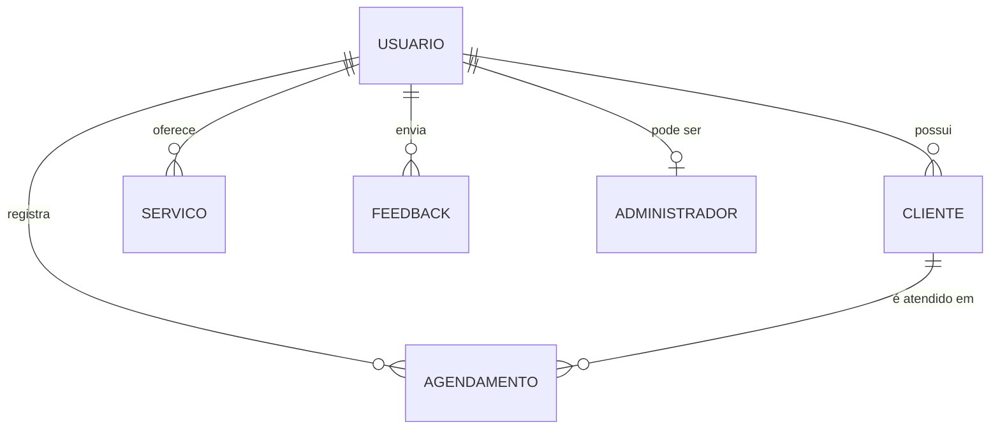
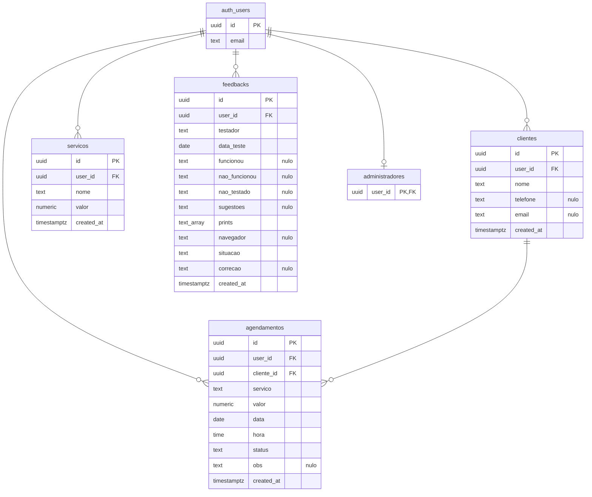

# Projeto de dados

SGBD: **PostgreSQL 17** gerenciado pelo [Supabase](https://supabase.com). O esquema físico está versionado em [`supabase/migrations/`](../../supabase/migrations/) e é aplicado com `supabase db reset` (local) ou `supabase db push` (nuvem).

## Modelo conceitual

## Modelo lógico (normalizado)

### Normalização

- **1FN**: todos os atributos são atômicos. A exceção consciente é `feedbacks.prints` (lista de até 5 caminhos de arquivo), que é sempre lida e gravada inteira junto com a avaliação e nunca consultada item a item.
- **2FN**: todas as tabelas têm chave primária simples (`uuid`), então não há dependência parcial.
- **3FN**: os dados do cliente ficam só em `clientes` e o agendamento os referencia por `cliente_id`.
- **Desnormalização intencional**: `agendamentos.servico` e `agendamentos.valor` guardam o nome e o preço **do momento do atendimento**. Se o preço do catálogo mudar ou o serviço for excluído, o histórico financeiro continua correto (RN09).

## Projeto físico

| Recurso | Uso |
|---|---|
| `CHECK` | valores ≥ 0, situação dentro da lista, nomes não vazios, avaliação com pelo menos um texto, no máximo 5 prints |
| `FOREIGN KEY ... ON DELETE RESTRICT` | impede excluir cliente com agendamentos (RN08) |
| `FOREIGN KEY ... ON DELETE CASCADE` | ao excluir a conta, todos os dados do usuário são apagados |
| `DEFAULT auth.uid()` | o dono do registro é preenchido pelo banco, não pela tela |
| Índices | `(user_id, data, hora)` para a agenda; `(user_id, lower(nome))` para a busca de cliente/serviço; `(cliente_id)` para o histórico do cliente |
| **Row Level Security** | cada usuário só lê e altera as próprias linhas; o administrador lê todas as avaliações |
| Storage (bucket `prints`) | privado, 5 MB por arquivo, só PNG/JPG/WEBP, uma pasta por usuário |

## Dicionário de dados

### `clientes`

| Coluna | Tipo | Nulo | Padrão | Restrições | Descrição |
|---|---|---|---|---|---|
| id | uuid | não | `gen_random_uuid()` | PK | Identificador |
| user_id | uuid | não | `auth.uid()` | FK → auth.users, cascade | Profissional dono do cadastro |
| nome | text | não | — | não vazio | Nome do cliente |
| telefone | text | sim | — | 10 a 13 dígitos (validado na aplicação) | Telefone com DDD, usado no WhatsApp |
| email | text | sim | — | formato de e-mail (aplicação), minúsculas | E-mail do cliente |
| created_at | timestamptz | não | `now()` | — | Data de cadastro |

### `servicos`

| Coluna | Tipo | Nulo | Padrão | Restrições | Descrição |
|---|---|---|---|---|---|
| id | uuid | não | `gen_random_uuid()` | PK | Identificador |
| user_id | uuid | não | `auth.uid()` | FK → auth.users, cascade | Profissional dono |
| nome | text | não | — | não vazio | Nome do serviço (ex.: “Manicure”) |
| valor | numeric(10,2) | não | 0 | ≥ 0 | Preço padrão, sugerido ao agendar |
| created_at | timestamptz | não | `now()` | — | Data de cadastro |

### `agendamentos`

| Coluna | Tipo | Nulo | Padrão | Restrições | Descrição |
|---|---|---|---|---|---|
| id | uuid | não | `gen_random_uuid()` | PK | Identificador |
| user_id | uuid | não | `auth.uid()` | FK → auth.users, cascade | Profissional dono |
| cliente_id | uuid | não | — | FK → clientes, **restrict**; cliente deve ser do mesmo usuário (RLS) | Cliente atendido |
| servico | text | não | — | não vazio | Nome do serviço no momento do atendimento |
| valor | numeric(10,2) | não | — | ≥ 0 | Valor cobrado |
| data | date | não | — | — | Dia do atendimento |
| hora | time | não | — | — | Horário de início |
| status | text | não | `'agendado'` | agendado, realizado, faltou, cancelado | Situação do atendimento |
| obs | text | sim | — | — | Observação livre |
| created_at | timestamptz | não | `now()` | — | Data de criação do registro |

### `feedbacks`

| Coluna | Tipo | Nulo | Padrão | Restrições | Descrição |
|---|---|---|---|---|---|
| id | uuid | não | `gen_random_uuid()` | PK | Identificador |
| user_id | uuid | não | `auth.uid()` | FK → auth.users, cascade | Conta do testador |
| testador | text | não | — | não vazio | Nome de quem testou |
| data_teste | date | não | `current_date` | — | Data do teste |
| funcionou | text | sim | — | ao menos um dos 4 textos preenchido | O que testou e funcionou |
| nao_funcionou | text | sim | — | 〃 | O que não funcionou e deve ser corrigido |
| nao_testado | text | sim | — | 〃 | Funcionalidade não testada |
| sugestoes | text | sim | — | 〃 | Sugestões de melhoria |
| prints | text[] | não | `'{}'` | até 5; caminhos na pasta do próprio usuário | Caminhos das imagens no bucket `prints` |
| navegador | text | sim | — | até 300 caracteres | User-agent, para reproduzir o erro |
| situacao | text | não | `'pendente'` | pendente, corrigido, nao_procede | Situação da correção (só o administrador altera) |
| correcao | text | sim | — | — | Descrição da correção feita |
| created_at | timestamptz | não | `now()` | — | Data de envio |

### `administradores`

| Coluna | Tipo | Nulo | Padrão | Restrições | Descrição |
|---|---|---|---|---|---|
| user_id | uuid | não | — | PK, FK → auth.users, cascade | Usuário com acesso ao laudo. Inserido manualmente pelo SQL Editor; sem acesso pela API. |

### Função `eh_admin()`

`boolean`, `SECURITY DEFINER`. Retorna se o usuário logado está em `administradores`. É usada nas políticas de RLS e pela tela de laudo.
