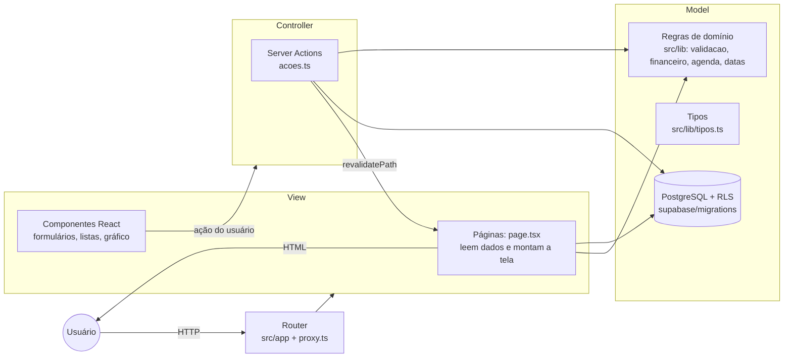

# Arquitetura

## Ficha técnica (campos da atividade de entrega)

| Campo | Resposta |
|---|---|
| Linguagem do back-end | **TypeScript** (Node.js), com Server Actions do Next.js |
| Banco de dados | **PostgreSQL 17** (Supabase) |
| Hospedagem | **Vercel** (aplicação) + **Supabase** (banco, autenticação e arquivos) |
| Plataforma | **Web responsiva** (computador e celular) |
| Modo de codificação | **Tradicional** (código escrito à mão; componentes visuais da biblioteca shadcn/ui) |

### Por que TypeScript e não Java, PHP, C# ou Python

O material sugere essas linguagens, mas não as exige. A escolha por TypeScript foi feita porque:

1. **Uma linguagem só** no front-end e no back-end. As regras de negócio (`src/lib/`) são as mesmas nas telas e no servidor, sem duplicar validação.
2. **Tipagem estática**, como em Java e C#: o compilador (`tsc --strict`) acusa erros antes de executar.
3. **Hospedagem gratuita e sem servidor para administrar** (Vercel), adequada a um projeto de extensão para MEIs.
4. Ecossistema de testes equivalente ao sugerido: **Vitest** (como JUnit/PHPUnit/pytest) e **Playwright** para testes de sistema.

## Padrão MVC

O Next.js (App Router) não usa os nomes “model/view/controller”, mas o código está separado exatamente nessas responsabilidades:



| Camada | Onde está | Responsabilidade |
|---|---|---|
| **Model** | `src/lib/validacao.ts`, `financeiro.ts`, `agenda.ts`, `datas.ts`, `tipos.ts` | Regras de negócio puras: validação, cálculos financeiros, conflito de horário, datas no fuso de São Paulo. Não acessam banco nem tela, por isso são 100% testáveis. |
| | `supabase/migrations/*.sql` | Esquema, restrições de integridade e políticas de acesso (RLS). |
| **View** | `src/app/**/page.tsx` | Páginas do servidor: consultam o banco e entregam os dados prontos. |
| | `src/app/**/*.tsx` (componentes `"use client"`), `src/components/` | Interação: formulários, calendário, gráfico, mensagens. |
| **Controller** | `src/app/(app)/acoes.ts`, `feedback/acoes.ts`, `login/acoes.ts` | Recebem a ação da tela, validam pelo Model, gravam no banco, traduzem erros do banco em mensagens e atualizam a tela. |
| **Router** | estrutura de pastas `src/app/` + `src/proxy.ts` | Rotas e proteção: quem não está logado é levado ao login. |

## Estrutura de pastas

```
src/
  app/
    (app)/                área logada (layout com menu)
      acoes.ts            controller: agendamentos, clientes, serviços
      agenda/             semana, mês e formulário de agendamento
      financeiro/         indicadores, gráfico e comparações
      clientes/ servicos/
      feedback/           avaliação dos testadores e laudo
      error.tsx           tela de erro inesperado
    login/                entrar e criar conta (controller: acoes.ts)
    auth/callback/        confirmação de e-mail
    not-found.tsx         404
  components/ui/          componentes shadcn/ui
  lib/                    model: regras de domínio e acesso ao Supabase
  proxy.ts                renova a sessão e protege as rotas
supabase/migrations/      esquema do banco (SQL)
tests/
  unidade/                Vitest: domínio e componentes React
  integracao/             Vitest: controller e RLS contra o Postgres local
  e2e/                    Playwright: sistema no navegador e capturas
docs/                     esta documentação
```

## Segurança

- **Autenticação** pelo Supabase Auth: senha com hash bcrypt, sessão em cookie `httpOnly` renovada pelo `proxy.ts`.
- **Autorização no banco** (Row Level Security): mesmo que alguém chame a API diretamente com a própria sessão, só enxerga as próprias linhas. Isso é testado em `tests/integracao/seguranca.test.ts`.
- **Validação dupla**: o controller valida pelo Model, e o banco tem restrições `CHECK` como última barreira.
- **Prints** em bucket privado, com links temporários de 1 hora no laudo.
- Nenhuma chave secreta no código. A aplicação usa apenas a chave pública (publishable), que é protegida pelo RLS.
