# Manual de uso

## 1. Criar conta e entrar

Acesse o endereço do sistema e clique em **Ainda não tenho conta**. Informe e-mail e uma senha de pelo menos 6 caracteres, depois abra o link que chega no seu e-mail para ativar a conta. Nas próximas vezes, basta **Entrar**.

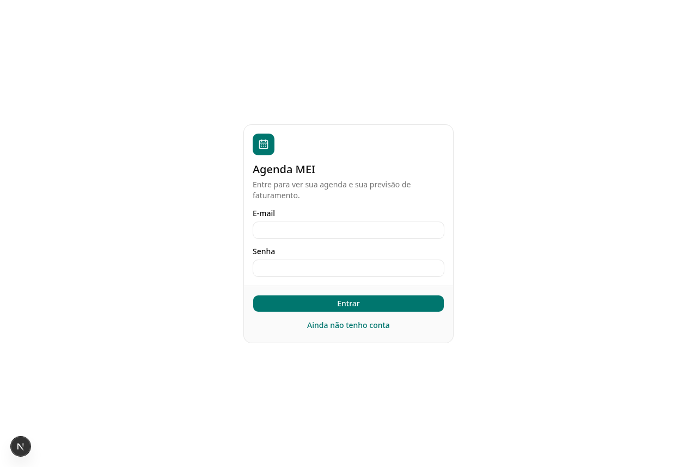

## 2. Agenda da semana

É a tela inicial. Mostra cada dia da semana com os atendimentos em ordem de horário e o total previsto do dia.

- **‹ Hoje ›**: navega entre as semanas.
- **Semana: N atendimentos · previsto · já realizado**: resumo da semana.
- **Atendimentos sem baixa** (quadro laranja): atendimentos que já passaram e continuam como “Agendado”. Marque se foi realizado ou se o cliente faltou para o financeiro ficar certo.
- Em cada atendimento:
  - **Situação** (Agendado / Realizado / Faltou / Cancelado): mude direto na lista.
  - **Balão de conversa**: abre o WhatsApp do cliente com a mensagem de lembrete pronta.
  - **Clique no horário ou no nome**: abre o atendimento para editar ou excluir.

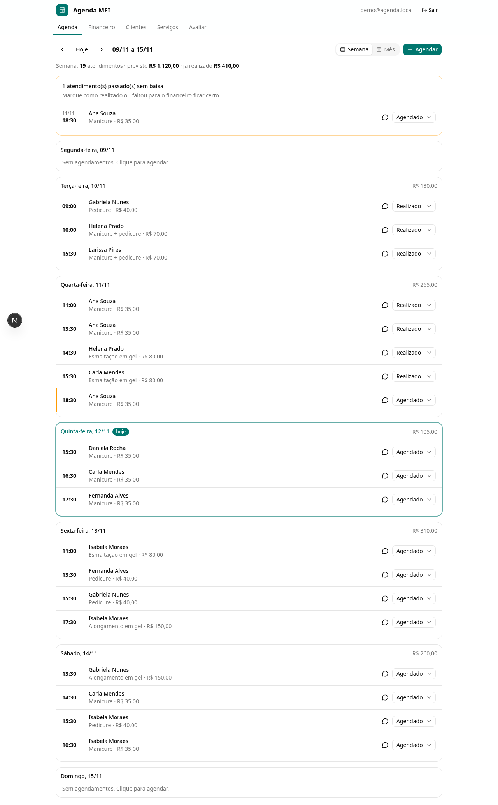

## 3. Agendar um atendimento

Clique em **+ Agendar**.

1. Confira a **data** e a **hora**.
2. Digite o **cliente**. Se já tiver atendido essa pessoa, o nome aparece na lista e o telefone e o e-mail são preenchidos sozinhos. Se for cliente novo, o sistema avisa “Cliente novo: será cadastrado”.
3. Digite o **serviço**. Se ele estiver no catálogo, o **valor** é preenchido, e você pode alterar se cobrou diferente.
4. Clique em **Salvar**.

Se já houver outro atendimento no mesmo horário, aparece um aviso. Mesmo assim é possível salvar.

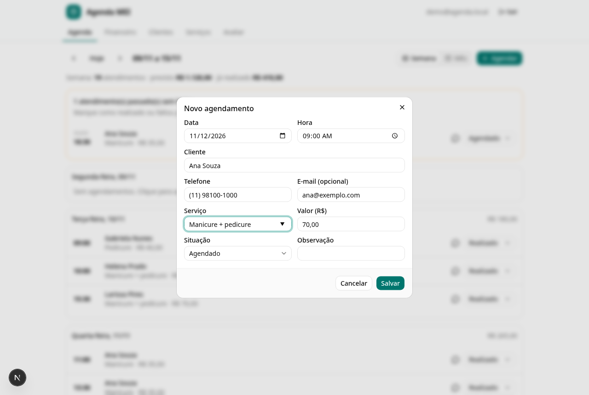

## 4. Calendário do mês

Clique em **Mês**, no canto superior direito. Cada dia mostra os primeiros horários com uma bolinha colorida da situação e o total previsto.

- **Um clique num dia** mostra a lista daquele dia abaixo do calendário.
- **Dois cliques num dia** abrem um agendamento novo nesse dia.
- No celular, cada atendimento aparece como uma bolinha.

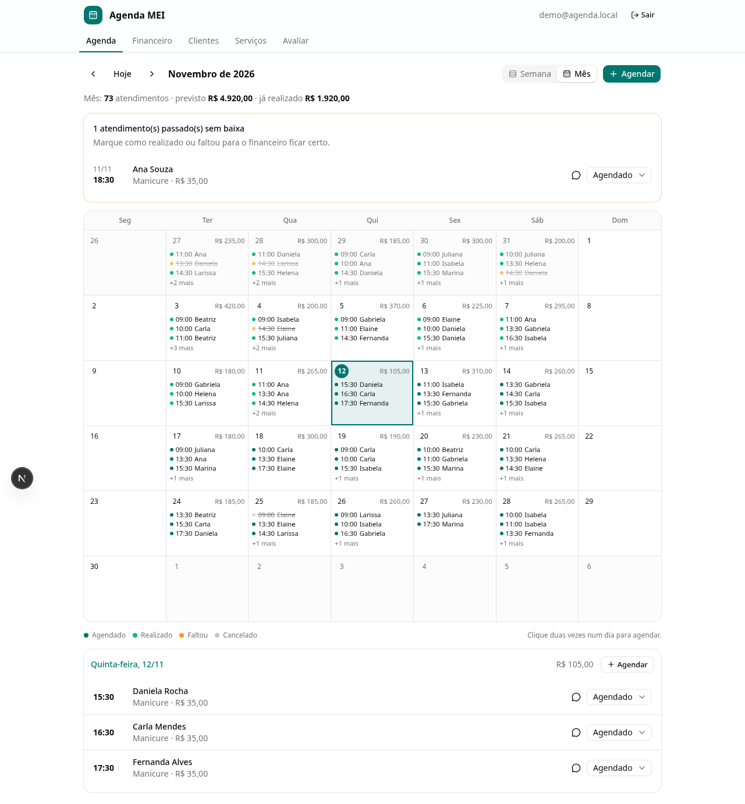

## 5. Financeiro

| Indicador | O que significa |
|---|---|
| **Previsão do mês** | Tudo o que foi realizado mais o que ainda está agendado no mês |
| **Já realizado** | Atendimentos marcados como realizados. No mês atual, compara com o mês anterior **até o mesmo dia** |
| **Ainda a receber** | Atendimentos agendados que ainda não aconteceram |
| **Perdido** | Valor de faltas e cancelamentos |
| **Atendimentos** | Quantidade de atendimentos agendados e realizados |
| **Ticket médio** | Valor médio por atendimento realizado |

Abaixo dos indicadores ficam o **gráfico dos últimos 6 meses**, a **tabela de comparação mês a mês** e os **serviços que mais faturaram** no mês. Use **‹ ›** para ver meses anteriores.

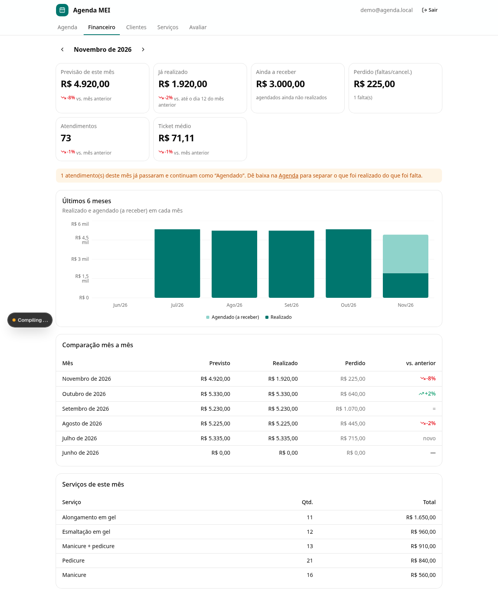

## 6. Clientes e serviços

- **Clientes**: busca por nome ou telefone. Mostra quantas vezes a pessoa foi atendida, quanto já gastou, quantas faltas teve e a data do último atendimento. O lápis edita e a lixeira exclui; só é possível excluir clientes sem agendamentos.
- **Serviços**: cadastre os serviços com o preço padrão. Excluir um serviço não altera os atendimentos antigos.

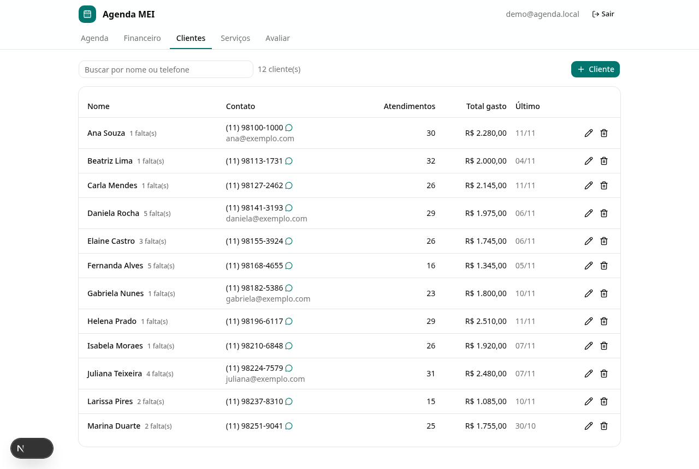
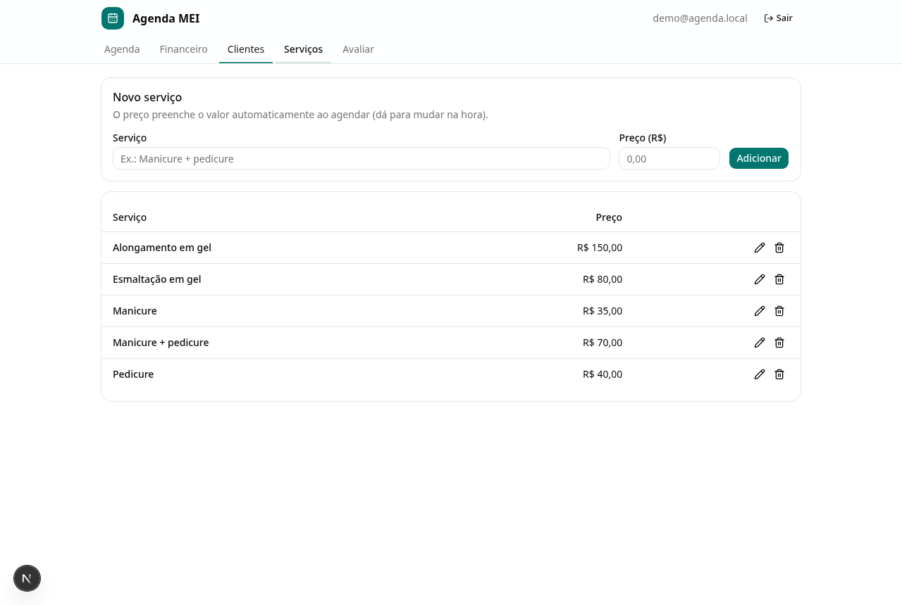

## 7. Avaliar o sistema (testadores)

Em **Avaliar**, preencha seu nome, a data, o que funcionou, o que não funcionou, o que você não testou e suas sugestões. Use **Adicionar print** para anexar até 5 imagens da tela com erro.

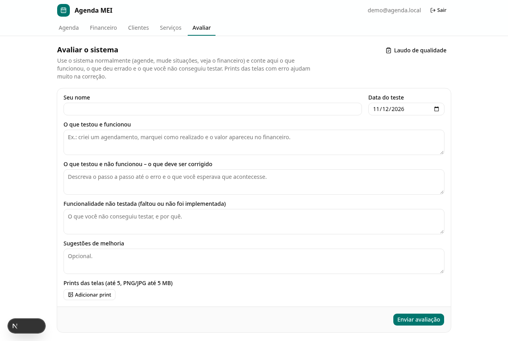

## 8. Laudo de qualidade (administrador)

Só aparece para o administrador, em **Avaliar → Laudo de qualidade**. Ele reúne todas as avaliações com os prints. Para cada problema relatado, escolha a situação (Pendente, Corrigido ou Não procede), descreva o que foi feito e clique em **Salvar correção**. O botão **Imprimir / salvar PDF** gera o documento de entrega.

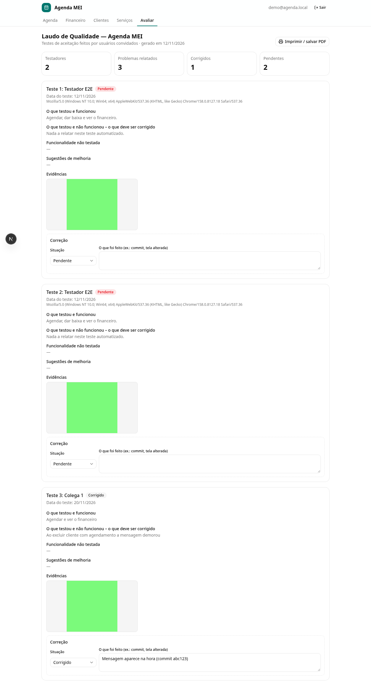

## 9. No celular

Todas as telas funcionam no navegador do celular. Para usar como aplicativo, abra o sistema no Chrome ou no Safari e escolha **Adicionar à tela inicial**.

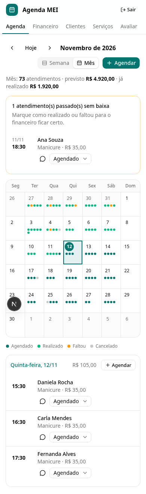 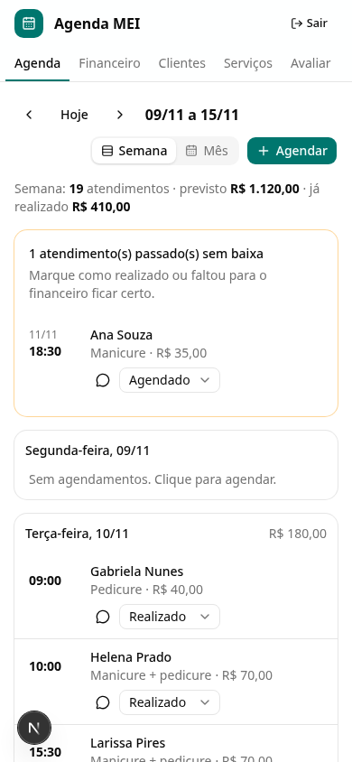
