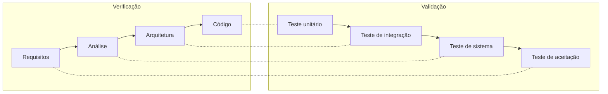

# Testes automatizados

A estratégia segue o **Modelo V** apresentado no material da disciplina: cada nível de especificação tem um nível de teste correspondente.



| Nível | Ferramenta | Arquivos | Testes | O que garante |
|---|---|---|---|---|
| **Unitário** (Model) | Vitest | `tests/unidade/*.test.ts` | 62 | Validação, cálculos financeiros, regras da agenda, datas e fuso, formatação |
| **Unitário** (View) | Vitest + Testing Library | `tests/unidade/*.test.tsx` | 11 | Formulário de agendamento, lista de clientes, login, alternância semana/mês |
| **Integração** (Controller + banco) | Vitest + Supabase local | `tests/integracao/` | 20 | Server Actions gravando no PostgreSQL real, RLS, Storage e permissões do laudo |
| **Sistema** (ponta a ponta) | Playwright + Chrome | `tests/e2e/fluxo-principal.spec.ts` | 5 | O sistema completo no navegador, como um usuário usaria |
| **Aceitação** | 5 testadores humanos | `/feedback` → laudo | — | Ver [Situação 3](../situacao-3-validacao/) |

**Total automatizado: 98 testes.** Todos rodam a cada push no GitHub Actions ([`.github/workflows/ci.yml`](../../.github/workflows/ci.yml)).

## Como rodar

```bash
npm test                 # unidade (não precisa de banco)
npm run test:integracao  # integração (precisa do `supabase start`)
npm run test:e2e         # sistema no navegador (precisa do Supabase local; sobe o servidor sozinho)
npm run lint && npm run typecheck
```

## O que cada suíte cobre

### Unidade: Model (`src/lib`)

- **validacao.test.ts** (25): conversão de valor com vírgula (“1.234,56”); recusa de data inexistente, hora inválida, valor negativo ou em texto, situação desconhecida, telefone sem DDD e e-mail sem domínio; normalização de espaços e maiúsculas; escape de `%` e `_` na busca.
- **datas.test.ts** (14): “hoje” no fuso de São Paulo com o relógio simulado às 22:30 do dia anterior em UTC; viradas de mês e ano; ano bissexto; segunda-feira da semana; grade do calendário com 4, 5 ou 6 semanas.
- **financeiro.test.ts** (7): previsão, realizado, a receber, perdido e ticket médio; mês vazio sem divisão por zero; ranking que agrupa “Corte” e “corte ”; comparação até o mesmo dia do mês anterior; variação sem base de comparação.
- **agenda-formato.test.ts** (8): conflito de horário (ignorando o próprio agendamento e os cancelados), atendimento sem baixa, agrupamento por dia, mensagem de lembrete, link do WhatsApp com DDI 55.
- **feedback.test.ts** (8): avaliação sem texto, print de outro usuário, caminho com `..`, mais de 5 prints, tipo e tamanho de imagem.

### Unidade: View (componentes React)

- **dialogo-agendamento.test.tsx** (5): ao digitar “ana souza”, o telefone e o e-mail do cadastro são preenchidos; o serviço preenche o valor “35,00”; aviso de cliente novo; aviso de conflito; ao salvar, envia os dados e fecha; em caso de erro do servidor, mostra a mensagem e mantém o formulário aberto.
- **telas.test.tsx** (6): busca de clientes por nome e por dígitos do telefone; estado vazio; link do WhatsApp; alternância entre entrar e criar conta; links das visões semana e mês.

### Integração (Controller + PostgreSQL)

- **acoes.test.ts** (7): criar agendamento cria também o cliente e o serviço; reaproveita “  maria TESTE ” e “escova” sem duplicar e mantém a grafia do catálogo; nome “Promo 50%” não é tratado como curinga; dados inválidos não gravam nada; mudar situação e excluir; cliente com agendamentos não pode ser excluído.
- **seguranca.test.ts** (5): outro usuário não vê, não altera e não exclui os dados; visitante sem login é bloqueado; não é possível agendar usando o cliente de outro usuário; o banco recusa valor negativo (`CHECK`).
- **feedback.test.ts** (8): prints só na própria pasta; Storage recusa arquivo que não é imagem; o testador não vê avaliações alheias nem marca a própria como corrigida; o administrador vê tudo, baixa o print e registra a correção.

### Sistema (Playwright)

1. Visitante sem login é levado à tela de entrada.
2. Senha errada mostra “E-mail ou senha incorretos.”
3. **Fluxo completo**: criar conta → agendar cliente novo → ver o previsto da semana → aviso de conflito → valor inválido recusado → dar baixa como realizado → conferir no financeiro, no calendário, em clientes e em serviços → sair.
4. Testador envia avaliação com print.
5. Página inexistente mostra 404 e volta para a agenda.

## Defeitos encontrados pelos testes

| Teste | Defeito | Correção |
|---|---|---|
| `datas.test.ts` | `ehData("2026-13-45")` era aceito: o JavaScript “transborda” datas inválidas para o ano seguinte | A data agora precisa voltar idêntica depois da conversão |
| Revisão das capturas (e2e) | A fonte caía para serif, porque a variável `--font-sans` apontava para si mesma | Variável corrigida no tema |
| Revisão das capturas (e2e) | “Já realizado −64%” comparava meio mês com o mês anterior inteiro | Comparação até o mesmo dia (RN04), com teste unitário |
| Revisão das capturas (e2e) | No celular, o valor do atendimento era cortado | Ações vão para uma segunda linha no celular |
| `integracao/feedback.test.ts` | O `service_role` não tinha permissão nas tabelas (padrão novo do Supabase) | `GRANT` explícito nas migrations |
| CI / GitHub | Chave secreta local escrita no código de teste foi bloqueada pelo *push protection* | Chaves lidas do `.env.local` e do ambiente da CI |
